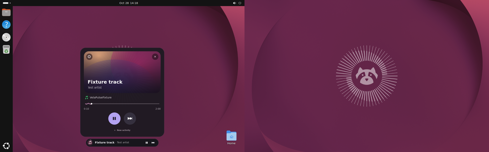

# VelaPulse

Native Linux live activities with quiet floating pills and expressive activity cards. A Rust session service drives a GNOME Shell extension and a GTK4 Wayland layer-shell client. This is a working **early milestone**, not a daily-use stability release.

## What works
- Countdown timers and stopwatches: start, pause, resume, reset, completion notification, suspend-aware boot time and restart recovery.
- MPRIS discovery, metadata, local artwork, extrapolated progress, capability-checked controls and player removal.
- UPower battery status and optional PipeWire/WirePlumber volume via `wpctl`.
- Priority-ordered activities; bounded, connection-owned external activities over session D-Bus.
- XDG configuration, themes, top/bottom placement, monitor selection, motion preference and daemon autostart.
- Slim pills with independent icon controls, artwork-first media cards, large timer readouts, activity switching and reduced-motion support.
- Native three-column preferences with live previews, pill and card sizes, appearance, opacity, floating placement or GNOME Top Bar, display, provider visibility and startup settings.
- GNOME pill/card with outside-click collapse, Escape, focusable controls and lifecycle cleanup.
- Automatic capability-based GTK layer-shell selection with renderer readiness, bounded retries and a connected GNOME fallback.
- D-Bus activation backed by a systemd user service; `velapulse doctor` diagnostics.
- Explicit local-task wrappers for builds, Codex and Claude Code sessions.
- Real layer-shell surface using GTK4, with zero exclusive zone and on-demand expanded keyboard input.

## Build and run
Requires Rust 1.99.1 (the version used for validation), a C linker, Linux and session D-Bus. The core does not require GTK development packages.

```sh
cargo build --release --locked
./target/release/velapulse capabilities
./target/release/velapulse daemon
# In another terminal:
./target/release/velapulse timer start 300
./target/release/velapulse stopwatch start
./target/release/velapulse snapshot
```

### GNOME 50

```sh
./scripts/install-user.sh
```

This installs user files, a settings launcher, a systemd user service and D-Bus
activation. The extension can request the service automatically after login;
manual service startup is no longer required. A newly installed/cached extension
may require logout/login. Autostart is off by default; on-demand activation still
works. See [installation and removal](docs/INSTALLATION.md).

### Native layer-shell sessions

```sh
./scripts/install-user.sh --native-only
velapulse snapshot
```

The daemon probes the actual Wayland registry and starts GTK only when supported.
The extension hides after native readiness and returns if GTK fails. Native
initialization is checked with an eight-second deadline and at most three failed
attempts. Mutter remains optional and independently maintained. Experimental
Mutter belongs in a disposable VM, never an automatic workstation installation.

### Preferences

Run `velapulse preferences`, open the installed VelaPulse Settings launcher, use the gear in a card, or use `gnome-extensions prefs velapulse@velapulse.local`, or run `./scripts/preferences.sh`. Preferences apply to the running service immediately. In Appearance, choose Placement → GNOME Top Bar to embed the compact activity in the GNOME panel. Floating pill restores the top/bottom overlay. The layer-shell client stays floating.

## External activities

```sh
./target/release/velapulse push '{"id":"build","title":"Building project","description":"Compiling","status":"active","progress":0.4,"expires_in":60}'
```

A CLI push is one-shot and expires. Applications updating/removing activities must retain a single D-Bus connection. See [the API contract](docs/API.md).

## Local development activities

```sh
velapulse run "Release build" -- cargo build --release
velapulse run "Codex session" -- codex
velapulse run "Claude Code session" -- claude
```

These wrappers use the public activity API and explicit commands, with no private
third-party API assumptions. See [integration examples](docs/INTEGRATIONS.md).

## Integration evidence and readiness

See [INTEGRATION_REPORT.md](INTEGRATION_REPORT.md) and
[RELEASE_READINESS.md](RELEASE_READINESS.md) for the current evidence and boundaries.
Actual VM screenshots are in [docs/screenshots](docs/screenshots).



Audio uses bounded 15-second sampling. Only local artwork is loaded; remote
artwork uses the original fallback. Spotify/browser compatibility, physical
hotplug, hardware wake and long-duration operation remain unverified. The GNOME
extension declares Shell 50 support. The VM's compositor uses software rendering;
its short resource sample is not a hardware performance certification.

## License and inspiration

Original code: MIT. Conceptual inspiration: [nixesty/now-bar](https://github.com/nixesty/now-bar), an unrelated GPL-3.0 Windows project. No code or assets were copied and there is no affiliation. See [provenance](docs/LEGAL.md) and [dependency inventory](docs/DEPENDENCIES.md). VelaPulse is a provisional name; this is not trademark clearance.
