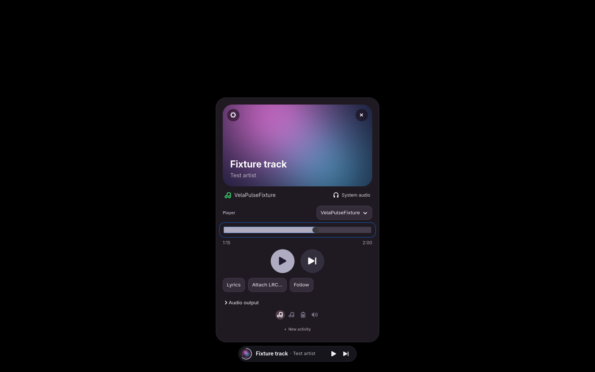
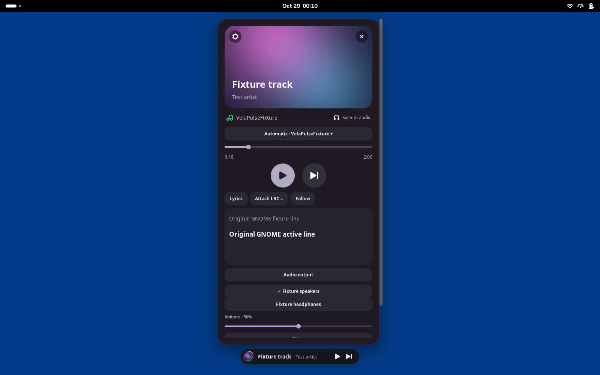
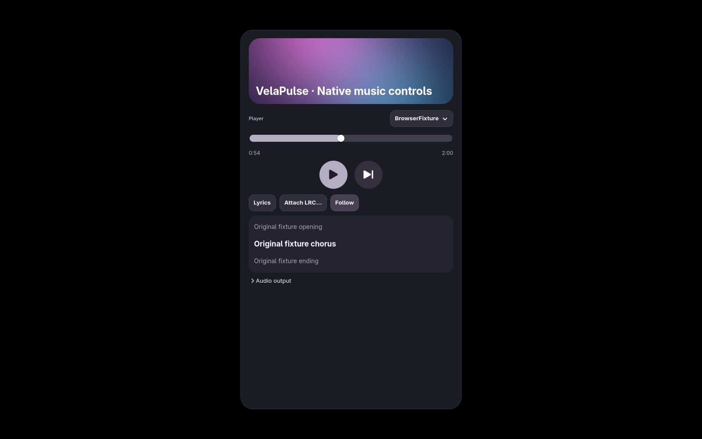

# Phase 1–2 implementation and verification report

## Revision and delivery

Branch: `feature/core-ui-advanced-music`, proposed against `integration/product-experience` in a new PR. Existing PR #1 is not overwritten or merged.

| Revision | Purpose |
| --- | --- |
| `714c55c3073adba41f2938b0e24410f358ba7128` | Verified integration baseline, including Dark/Light/Liquid Glass |
| `0ff179ce589bcb3d4cd09463eef59209cf4380d4` | Inherited, demonstrated preferences modal-input fix |
| `f9dac0acebbe4cc5e6d81c7c61218ec4507b877a` | Advanced MPRIS, artwork, lyrics, audio and history services |
| `d49a91c3546f9cbe5197fc404a815a5da32320bd` | Shared UI controls, renderer integration, artwork retry, real-input tests and documentation |

This report and unedited evidence are committed separately after those implementation revisions. Phases 3–7 remain planned in [PRODUCT_ROADMAP.md](PRODUCT_ROADMAP.md). No Galaxy Buds-specific functionality was added. Reference screenshots informed feature density; no reference implementation, music artwork or lyric collection was copied.

## Preferences: root cause and verified fix

The old GNOME extension preferences wrapper hid GNOME's modal tracking window and presented a separate GTK window. The hidden modal host retained GTK's input grab. Controls in the visible child were mapped and sensitive, but pointer and keyboard events went to the hidden host, so their callbacks never ran. This was not a transparent overlay or individual broken settings binding.

`extension/preferences-host.js` transfers modality from the host to its visible transient child and couples their close lifecycle. `extension/prefs.js` uses that wrapper. The fix is inherited from the integration baseline and was verified before major music implementation. The regression harness recreates the old wrapper: six input events reach the hidden host, none reach the visible child. The fixed wrapper and standalone settings path each receive 164 pointer events and 148 key events, with none redirected to the hidden host.

The user originally reported the Settings launcher path. A fresh instrumented window using the installed shared settings module responded, as the user confirmed. Thus the hidden-modal failure is conclusively reproduced for the GNOME wrapper; the original stale standalone launcher freeze is not independently reproduced or conclusively attributed. This distinction matters when diagnosing an already-open installed window.

Actual GTK pointer/key tests cover all eight sidebar destinations, search entry/filter/clear, provider checkboxes, all five pill/card size selectors, Dark/Light/Glass, opacity, position/placement, animation, renderer/display choices, login switch in a private XDG directory, provider enable/priority controls, history opt-in/disable/refresh/clear confirmation, timer and stopwatch controls, About URI dispatch, closing and settings durability after daemon restart. Tests assert both applied UI state and saved configuration. See [fixed](evidence/phase-1-2/preferences-fixed.txt), [standalone](evidence/phase-1-2/preferences-standalone.txt) and [legacy](evidence/phase-1-2/preferences-legacy.txt) results.

## Implemented experience

- Shared presentation rules preserve timer, stopwatch, battery, audio and external activities. Music pill width responds to content within a bound; artwork is cached in the pill, long text ellipsizes, progress and capability-aware transport remain visible when paused.
- Expanded music cards share visual conventions across native GTK and stock GNOME: artwork hero, extracted accent, player identity/selection, elapsed/duration, interactive seek, transport, optional lyrics and audio. Scroll containers bound tall content to monitor space. Escape and collapse restore compact geometry. Artwork crossfades respect reduced motion; overview entry cleans up GNOME's expanded card.
- Dark, Light and transparent Liquid Glass are inherited and retained. Glass uses translucent surfaces/highlights; this does not promise compositor background blur or optical refraction on stock GNOME. No compositor modification is required.
- MPRIS discovers/removes standard players, observes status/metadata/seek signals, interpolates playback position once per second, resynchronizes active players every 15 seconds, validates seek track IDs/capabilities/duration, and persists manual player choice. Automatic selection favors playing sources. Unsupported controls are absent/disabled and unknown-duration tracks remain usable.
- Artwork fetch/decode runs asynchronously with bounded concurrency, deadlines, image/payload/cache limits, cancellation, stale-result protection and capped retry/backoff. Anonymous public HTTPS only; credentials, redirects, proxies and private/reserved destinations are rejected. DNS answers are checked and pinned. Local regular PNG/JPEG/WebP files are normalized to a bounded PNG; raw remote/SVG URLs never reach the UI. Missing art uses the original Orbit asset.
- Local UTF-8 LRC files use a real chooser, timestamp/offset parsing, current-line highlighting, seek synchronization, automatic following and manual scrolling/Follow. Import rejects a changed track and writes atomically with restrictive file permissions. No remote lyrics provider is configured, no scraping occurs and no lyrics are bundled.
- PipeWire/WirePlumber support lists outputs/default, changes default, adjusts volume and toggles mute using bounded fixed-argument tools and readback. Default output is distinguished from per-application routing; unsupported operations show an error.
- Listening history is explicitly off by default, local only, bounded/retained, mode 0600. Paused, duplicate and suspend-length time is excluded. Recent tracks, weekly totals, ranked songs/artists and daily UTC totals are shown. Disable stops collection; Clear requires confirmation.

Main changed areas: `src/{music,artwork,lyrics,audio,history,main,model,config,providers}.rs`; shared `extension/music-{state,controls,shell,preferences}.js`; `extension/lyrics-picker.js`; both renderer modules/styles; installer module lists; API/config/architecture/dependency documentation; isolated regression fixtures and CI. See [MUSIC.md](MUSIC.md) for usage and precise limits.

## Verification and provenance

| Check | Actual result and boundary |
| --- | --- |
| Rust format / Clippy all targets / unit tests / release build | Passed. 9 unit tests passed; the opt-in network test is ignored in the default run and separately passed against a chosen public HTTPS image. |
| Core integration | Passed timer pause/resume/completion/reset, stopwatch, expiry, validation, persistence and single instance. |
| Provider and activation regressions | Passed MPRIS discovery/signals/controls/removal, external ownership/quotas, isolated D-Bus activation/reactivation and persisted timer recovery. |
| Advanced music contract suite | Passed two deterministic peers, stable manual choice while paused, seek/stale-track/capability rejection, unknown duration, track/art changes, normalized artwork, LRC, opt-in/disable/clear history, all private audio commands, disconnect and restart. |
| GTK preferences | Real Wayland pointer and keyboard events delivered through a marked private Sway compositor; all controls above passed. No host settings changed. |
| GTK music component | Real pointer/key player chooser, pause, drag and keyboard seeking, native file picker/LRC import, line synchronization/Follow, default output, volume, mute, Next and stable choice passed. See [input log](evidence/phase-1-2/gtk-music-input.txt). |
| Full native renderer | Actual production layer surface passed pointer expansion, player chooser, transport, seek and Escape collapse. Temporary source copy records geometry only; official layer-shell preload is used. |
| Stock GNOME 50 | Separate stock headless GNOME session loaded extension ACTIVE with no extension errors. Real St button signal activation passed expansion/collapse, pause, lyrics and audio. This is callback/render verification, **not physical pointer/key delivery on the user's GNOME desktop**. |
| Real player | Distribution mpv + mpv-mpris, generated 90-second silence, null audio/video and no user profile: discovery, duration, CanSeek, pause, seek, resume, progress and removal passed. Spotify/Firefox/Chromium live playback was not exercised; similarly named fixture peers are not real applications. |
| Real host audio | Read-only private-bus query found one actual output, valid default/volume/mute state. No output/volume/mute mutation was performed. Mutating controls were tested against isolated tools only. |
| Presentation/syntax | Shared presentation tests, module syntax and diff whitespace checks passed. |

Fixtures are test-only and are not installed. Sway/Gtk4LayerShell and the optional mpv plugin were extracted into workspace test directories; no system dependency was installed. Private D-Bus configuration excludes ambient activation services. Tests use private XDG configuration, data, cache and runtime directories. The GNOME test instruments a disposable extension copy without Shell Eval or active-session edits.

Reproduce using [DEVELOPMENT.md](DEVELOPMENT.md), `scripts/test-preferences-input.sh`, `scripts/test-music.sh`, `scripts/test-music-input.sh` with `VELAPULSE_TEST_NATIVE=1`, and optional `tests/gnome_smoke.py` / `tests/real_player.py`. CI runs the deterministic Rust, GTK input, music, core, provider and activation suites and uploads evidence. Real-player/network/headless GNOME checks are optional local checks, not claimed as CI coverage.

## Genuine screenshots

These are unedited captures of actual rendered components using original deterministic track/art/LRC fixtures; fixture content does not represent a real song or streaming account.

Production GTK layer renderer after real input:

Production compact pill after Escape:

Stock GNOME 50 extension in a separate headless desktop, lyrics/audio expanded (lower controls available by scrolling):

Production GTK controls inside the focused input harness, including synchronized lyrics:

## Measured performance

Local debug daemon, three-second samples per state, 30 sequential Snapshot RPCs. CPU is percentage of one logical CPU. These short samples exclude renderer footprint and are not a hardware/endurance certification. See [raw measurements](evidence/phase-1-2/performance.json).

| State | RSS | CPU | Snapshot median / maximum |
| --- | --- | --- | --- |
| Idle | 17,564 KiB | 0.67% | 0.93 / 1.28 ms |
| Two active fixture players | 20,380 KiB | 0.67% | 1.02 / 1.42 ms |

## Installed environment and remaining gates

The installed binary remains unchanged, SHA-256 `57ab4355170bd6f78e825bbc90669e873a3b5561231eef4133cf5be7d9726d13`. Installed shared preferences source matches `1e88bf1becc71cc42dfe9e51cce49ebcb1701f56`. The existing user service remains active. No old installation was removed, no new binary/modules were installed, no user activities were stopped and no login/service configuration was changed. New-build systemd login startup and live desktop handoff therefore are **not deployment-verified**. Isolated activation/recovery passed; this is separate from installation acceptance.

Remaining acceptance work: physical pointer/key interaction in stock GNOME on the user's desktop; actual Spotify and browser MPRIS sessions; real output switching/hotplug; new-build multi-monitor/fractional-scale/fullscreen/lock/reconnect/suspend scenarios and long-duration renderer/resource testing. Existing baseline supports monitor-aware positioning and renderer supervision, but those complete live scenarios were not newly certified by this branch. Remote lyrics require a permitted provider before implementation. Glass transparency does not add compositor blur. Accessibility/localization and final distribution remain Phase 7 work.

No Mutter, system compositor libraries, GDM, unrelated services or personal saved data were modified. No automatic logout/reboot or PR merge occurred. Installing this tested build into the user's environment remains a separate explicitly approved step.
