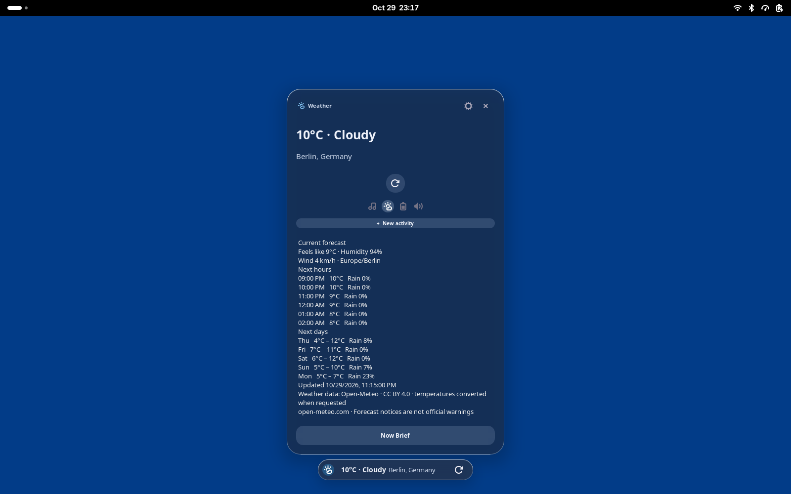
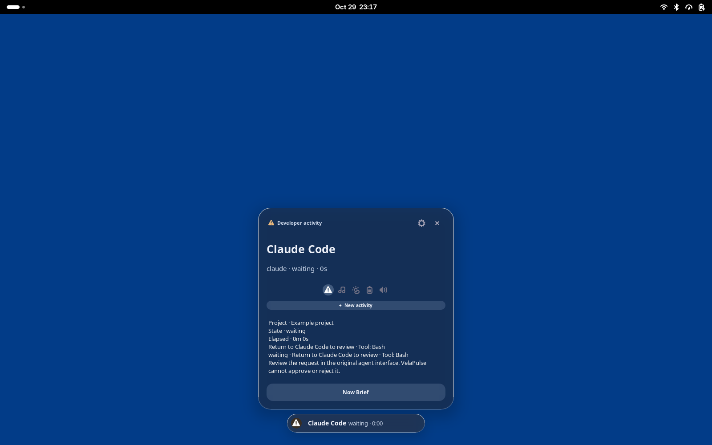
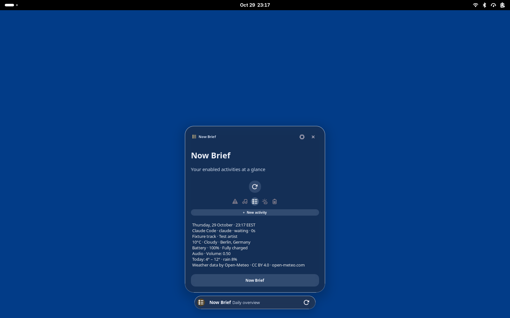

# Phase 3 and Phase 4 implementation report

## Scope and revision

PR: https://github.com/AbdulrahmanAhmedGit/velapulse-linux/pull/3

Branch: `feature/weather-ai-activities`, stacked on `feature/core-ui-advanced-music` at `de4bc487bc4f3b08c05370f597be454b0f2f45ac`. Main implementation: `2f75cf9ab3e38c5c57290caa667863410a9ee9e0`. Cached-midnight correction: `0d7ad274d9bf0f6468e5ac8bc3d2e5bed05ff2fb`. Card-focus, compact labels and input/privacy refinements: `a23a2df6e9c15f684d26e2f1785aceccd4f97eb7`. Explicit hook-path UI and expanded real-input coverage: `5d72c27a43f77b945f662f870b667ecaa1902a50`.

Only Phases 3–4 are included. No Galaxy Buds, calendar accounts or Phases 5–7. This development session did not install the feature branch into the active user environment, change running user services or external agent settings, install system packages, or modify Mutter. Installation requires separate approval under the mission's host-safety rule.

## Delivered behavior

- Opt-in weather with manual city search and saved selection, Celsius/Fahrenheit, configurable refresh, current/feels-like temperature, humidity, wind, hourly/daily forecasts, location-timezone formatting, cache/error/stale indicators and attribution. Cached forecasts select the correct day across midnight.
- Bounded asynchronous HTTPS transport, request limits, retry backoff and a single private cache. Fresh persisted data avoids an immediate request after restart; stale data older than 48 hours is discarded.
- Independently configurable rain and temperature-change notices, deduplicated across restart. These are forecast-derived notices, **not official severe-weather warnings**.
- Optional local idle clock with 12/24-hour display and temperature. It yields to foreground work.
- Now Brief from the expanded card: date/time, available weather/today's forecast, notices, timers, music and developer summaries. It is a refreshable two-minute snapshot and works with missing/disabled modules.
- Concurrent developer activities with bounded history, real state/elapsed time, optional validated progress, attention/completion ordering and per-provider transition notifications. Restarted/nonresponsive sessions become disconnected; commands do not resume automatically.
- Explicit owned-command monitoring through `velapulse run`, actual exit status, heartbeats and cancellation restricted to its own process group. A lost daemon stops the owned group. An externally SIGKILLed wrapper cannot guarantee cleanup of descendants; its activity becomes stale within 45 seconds.
- Opt-in `velapulse codex` observes documented `codex exec --json` lifecycle events. Existing interactive CLI/desktop sessions are not monitored. No unsupported permission-return channel is claimed.
- Opt-in Claude observer hooks use documented lifecycle/tool/notification/permission events. They retain sanitized lifecycle metadata, omit prompts, tool arguments and transcripts, and never return permission decisions. Attention directs the user to Claude for the actual command, scope and approval.
- Preferences offers an explicit settings-file path and confirmation for hook installation/removal, preserving other hooks/settings with backups. CLI setup defaults to dry-run. Uninstall refuses to remove observer scripts while registered settings still reference them.
- Existing Dark, Light and Liquid Glass styles, music controls and renderer choices are retained. The native renderer restores keyboard focus when cancellation removes the focused action, so Escape still collapses the card.

See [setup and privacy](WEATHER_AND_AGENTS.md), [D-Bus contract](API.md), [architecture](ARCHITECTURE.md) and [roadmap](PRODUCT_ROADMAP.md).

## Provider and integration sources

Weather uses [Open-Meteo forecast](https://open-meteo.com/en/docs) and [geocoding](https://open-meteo.com/en/docs/geocoding-api). Weather data is CC BY 4.0 with attribution; geocoding also credits GeoNames. The [free service terms](https://open-meteo.com/en/terms) restrict non-commercial use and set quotas; commercial deployment needs an appropriate plan/provider. No credentials are embedded.

No automatic/IP-based location is implemented. Searches and selected coordinates go to Open-Meteo only when used/enabled; the provider also sees the network IP. Weather/Codex/Claude default off. No telemetry is added. State/cache files use mode 0600 and bounded histories. Session-bus same-user trust applies; this is not isolation between hostile processes of the same user.

Adapters follow [Codex structured output](https://developers.openai.com/codex/noninteractive/) and [Claude hooks](https://code.claude.com/docs/en/hooks), checked against installed Codex 0.164.0 and Claude Code 2.1.310.

## Validation and provenance

Development tests ran in private D-Bus sessions and disposable configurations. Native pointer/keyboard tests used a private headless Sway compositor and virtual input. Stock GNOME tests used a private stock GNOME 50 session with actual St callback activation; **they do not prove physical mouse input on the user's active desktop**.

| Validation | Actual result and limits |
| --- | --- |
| Rust format, strict Clippy, unit tests, release build | Passed; 18 unit tests passed, one unrelated opt-in artwork network test ignored. |
| Weather transport/data | Local HTTP success/503/invalid/oversized responses; units, invalid locations, stale/offline cache, notice categories and midnight boundary passed. Actual Open-Meteo search/forecast requests also passed. |
| Core/D-Bus/providers | Timer, stopwatch, persistence, single instance, activation/reactivation, MPRIS and external ownership/quota checks passed. |
| Phase 3–4 contracts | Defaults, clock/brief, missing providers, real command completion/failure/concurrency/cancel, daemon restart/disconnect, hook mappings/dedup/privacy, permission limits and safe settings merge/removal passed. |
| Real Codex | Explicit ephemeral read-only test completed successfully, five lifecycle events. This exercised the installed CLI/model, not a synthetic JSONL fixture. |
| Real Claude | Installed executable invoked three observer events but exited 1: “Not logged in · Please run /login”. Lifecycle ended disconnected. Full model completion/failure and real permission-request flows remain unverified. |
| Native renderer real input | Music/player/seek/audio regression, Now Brief open, owned-task selection/cancellation and Escape collapse passed. |
| Preferences real input | Weather settings, interval/refresh, developer opt-ins, existing appearance/navigation/search/control regression and persistence are covered. Hook path entry, explicit install/remove confirmation and preservation of unrelated settings passed. Both standalone and extension-host launch paths delivered 228 pointer events and 272 key events to the visible window, with none redirected to the hidden host; saved settings survived a private-daemon restart. |
| Stock GNOME | Extension ACTIVE, no extension errors; weather, synthetic agent attention and Now Brief cards/actions passed. Glass transparency and Dark restoration passed. Agent attention shown in screenshots is a fixture, not a real Claude request. |

The first CI run (`40942706426`) exposed loss of the keyboard target after cancel removed its button. A focus fallback and a test waiting for the cancelled state correct that path. The corrected implementation passed CI run `40946748728` at `a23a2df`. Final branch CI status is visible on PR #3; no PR is automatically merged.

## Genuine screenshots

These are unedited captures of the private stock GNOME session. Weather uses cached data from a real API response; the developer attention card uses a synthetic event; music shown in Now Brief is an original test fixture. They are development captures, not current weather or the active user's sessions.

## Performance and network behavior

Short debug-daemon samples (two seconds each; 30 Snapshot RPCs) measured:

| Scenario | CPU | RSS | Median/max Snapshot latency |
| --- | --- | --- | --- |
| Weather disabled, idle | below sampling resolution (0.0%) | 18,072 KiB | 0.96 / 1.51 ms |
| Two sleeping owned commands | below sampling resolution (0.0%) | 18,412 KiB | 1.17 / 1.67 ms |

These exclude renderer/wrapper memory and are not endurance or hardware certification. Zero measured CPU is not a guarantee of zero work. See the saved metrics for reproducible scope. Disabled weather gates search/forecast requests; enabled background requests follow the configured interval, bounded manual refresh and retry backoff. This is verified code/test behavior, not an independent packet trace.

## Remaining limits and installation

Claude authentication is the blocker for full real-agent validation. Official severe-warning coverage, permission-aware automatic location and existing interactive Codex-session monitoring are unavailable in this implementation. A quiet Claude session becomes stale after 30 minutes without hooks. Notification delivery follows desktop quiet-mode policy; permission decisions always remain in the original agent.

Physical stock-GNOME input, hardware hotplug/multiple-monitor/scaling/suspend behavior and long-duration load are not newly certified here. No active desktop restart/logout was performed. To install after review, obtain explicit user approval, back up the current user installation/configuration and use the documented official user installer; do not patch the compositor. External hook installation is a separate explicit opt-in action.
