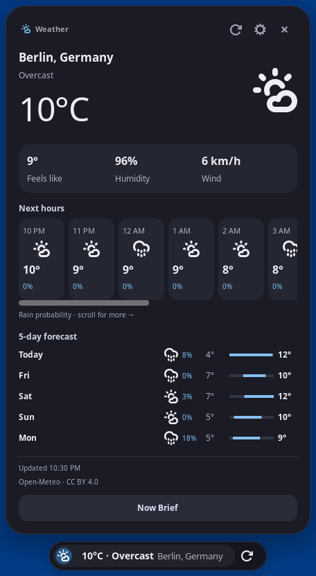

# Phase 3–4 UI quality correction

## Result and root cause

The former Weather card rendered structured forecasts through `activityLines().join('\n')` inside the generic activity template. That discarded the forecast hierarchy and left generic navigation between the header and useful content. Successful provider tests and button callbacks did not detect the visual failure.

Weather, developer activities and Now Brief now use a shared keyed component tree (`extension/context-cards.js`) with separate real GTK4 (`context-gtk.js`) and GNOME St (`context-shell.js`) adapters. Both production renderers use those components. The text-dump renderer was removed. Rust provider, caching, settings and approval logic were preserved.

Implementation commits: `3718861` and `8bff503`, followed by the screenshot/report polish commit on [PR #3](https://github.com/AbdulrahmanAhmedGit/velapulse-linux/pull/3).

This is a direct Shell screenshot-area capture of the actual private GNOME card and pill, not a mockup or edited image. Weather is a captured real Open-Meteo response for Berlin; it is not a current forecast for the reader.

## Delivered interface

- Location, condition, large temperature and weather icon, with refresh/settings/collapse controls.
- Compact feels-like, humidity and wind grid; unavailable values are omitted or identified safely.
- Horizontally scrollable hourly tiles with time, icon, temperature and precipitation. Pointer scrollbar dragging and keyboard Home/End work.
- Daily rows with day, icon, precipitation, low/high temperatures and a normalized drawn temperature range.
- Distinct forecast notices without official-warning claims. Cached/offline and empty states are explicit. Update time and attribution stay in a small footer.
- Bounded card height and vertical scrolling when needed; the hourly scrollbar has its own space. Dark, Light and Liquid Glass styles apply to the structured content.
- Developer identity, project, state, elapsed time, latest update and recent history have separate components. Raw adapter event strings become readable status labels. Waiting states direct decisions to the original agent; no permission approval buttons were added. Cancellation remains restricted to owned tasks.
- Now Brief uses individual summary tiles rather than concatenated paragraphs. Generic activity navigation is absent from Weather and developer content.
- Keyed reconciliation preserves scroll and focus across updates. Actual GNOME input testing found and corrected missing keyboard focus after expansion; collapse releases the card's focus. The outer St scroll container receives pointer scrolling. GNOME 50 preferences launch also handles its non-Promise return value.

Changed production areas: `extension/context-{cards,gtk,shell,state}.js`, `extension/presentation.js`, `extension/extension.js`, `backends/layer-shell.js`, both renderer stylesheets and the official installer module list. New semantic, native-input and GNOME-input coverage is integrated into the test scripts and CI.

## Actual validation and limits

| Check | Result and provenance |
| --- | --- |
| Rust format, strict Clippy, release build | Passed. |
| Rust unit tests | 18 passed; one unrelated opt-in artwork network test ignored. |
| Core/provider/activation/Phase 3–4 contracts | Passed; working backend and security restrictions preserved. |
| Shared presentation/component tests | Passed, including units, unknown conditions, missing/offline forecasts, permission limits and stable scroll-node reconciliation. |
| Native GTK, 100% and 125% | Actual virtual pointer/keyboard in private Sway: select, expand, refresh, Now Brief, hourly keyboard scrolling and Escape; Dark/Light/Glass, offline/empty and agent states. Private settings survived daemon restart. Forecast data and agent states in this suite are declared fixtures. Pointer hourly scrollbar dragging was additionally verified at 100%. |
| Stock GNOME 50, 100% and 125% | Actual EIS pointer/keyboard in a private GNOME session: expand/collapse, forecast/agent selection, refresh, Now Brief, hourly Home/End and Escape; pointer vertical scrolling at 125%. Extension ACTIVE with no extension errors. This mode does not emit widget activation signals to imitate input. |
| Existing music regression | Native player selection, transport, pointer/keyboard seeking, lyrics/file chooser, audio/output/mute, cancellation and Escape passed. GNOME transport/lyrics/audio regression also passed. |
| Weather external data | Real Open-Meteo response shown in GNOME; forced offline/stale and empty states use explicitly labeled private UI fixtures. |
| Codex | Actual ephemeral read-only CLI/model task exited 0 and produced a completed card. Synthetic running/completed/failed states are also covered separately. |
| Claude Code | Waiting/attention layout and actions are fixture-based. Real model and real permission-request interaction remain unverified because the installed CLI was not authenticated. |
| CI | Implementation checks passed at `8bff503` (runs 40957945332 and 40957936255); final report/polish revision is checked on PR #3. |

These are software-rendered isolated desktop tests, including genuine input delivery, not certification of physical mouse/keyboard, GPU, multiple monitors, hotplug, suspend or long-duration behavior on the active host. No compositor was modified or restarted.

Evidence logs are in [evidence/ui-quality](evidence/ui-quality). Their legacy final GNOME summary says “St button activation”; in EIS mode the explicit preceding EIS result is authoritative: actual events are delivered and the script does not call widget activation. No raw agent transcript, private configuration or user backup is published.

## Genuine screenshot gallery

All files below are direct renderer captures. Offline/empty and Claude/agent state fixtures are labeled. Test-session background and remote-input indicator are expected.

| View | Capture |
| --- | --- |
| Compact weather | [GNOME pill](screenshots/ui-quality/gnome-weather-pill.png) |
| Dark Weather | [GNOME](screenshots/ui-quality/gnome-weather-dark.png), [GTK](screenshots/ui-quality/native-weather-dark.png) |
| Light Weather | [GNOME](screenshots/ui-quality/gnome-weather-light.png), [GTK](screenshots/ui-quality/native-weather-light.png) |
| Liquid Glass Weather | [GNOME](screenshots/ui-quality/gnome-weather.png), [GTK](screenshots/ui-quality/native-weather-glass.png) |
| Hourly scrolled | [GNOME keyboard](screenshots/ui-quality/gnome-hours-end.png), [GTK pointer](screenshots/ui-quality/native-hours-pointer.png) |
| Daily forecast | Visible in the Weather captures above. |
| Offline / empty fixtures | [GNOME cached offline](screenshots/ui-quality/gnome-weather-offline-fixture.png), [GTK empty](screenshots/ui-quality/native-weather-empty-fixture.png) |
| Now Brief | [GNOME mixed real-weather and test-activity data](screenshots/ui-quality/gnome-brief.png) |
| Real Codex completion | [Actual task](screenshots/ui-quality/gnome-real-codex-completed.png) |
| Claude attention fixture | [Waiting card](screenshots/ui-quality/gnome-developer.png) |
| Failed agent fixture | [GTK failed state](screenshots/ui-quality/native-codex-failed.png) |
| Fractional scaling | [GNOME Light at 125%](screenshots/ui-quality/gnome-weather-light-125.png) |

## Reproduction and installation boundary

See [Development](DEVELOPMENT.md) for private-session test commands. The GNOME input helper uses libei and refuses unmarked runtimes; the harness checks that the remote-desktop bus belongs to its spawned private Shell. Test instrumentation is added only to disposable copies. It is not shipped by the installer.

The existing installed version remains `19caabbd12dcde338e1859e4b313fd01beefe3af` from the earlier authorized update. Its binary was checked against that update's manifest and its user service remained active. **This UI correction has not been installed.** Installation needs separate user approval, backup and verification. No Mutter, active extension files, user services, external agent settings or system packages were changed for this correction.
