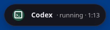

# Global spacing and alignment correction

## Root causes and changes

The compact pill combined several generations of geometry rules: 4px on its left versus 9px on its right, a second right inset on the action group, and a rounded hover/focus background on the inner summary button. Some action targets were only 21–28px. An empty action box still reserved its layout gap. The resulting edges depended on the activity and interaction state.

Width was estimated from raw title/description character counts, although the displayed strings differ for Weather, Timer and Now Brief. GTK additionally capped the title and subtitle at 14/16 characters. A size request was a minimum, so longer natural content could expand the GTK surface beyond the selected size. GNOME and GTK used different nested gaps and text sizing.

The fix gives geometry one owner:

- `extension/layout.js` defines the shared logical-pixel spacing and component tokens.
- `scripts/generate-layout-css.mjs` generates geometry sections in the GNOME, native GTK and preferences stylesheets. Conflicting older geometry declarations are removed while existing palettes remain. CI rejects stale generated styles.
- Both renderers use one pill surface, symmetric padding, a centered activity indicator, an expanding text group and an optional action group. Empty action groups disappear. Text uses relative font sizes and ellipsizes inside its allocation; complete titles are not limited by character count.
- GNOME measures the displayed labels. GTK measures its child layout in a small custom widget that bounds the natural width. Selected Small/Normal/Large sizes are ceilings, not mandatory empty space.
- Inner summary hover/active backgrounds are transparent. Keyboard focus remains visible through a restrained underline. Icon actions retain distinct hover/focus feedback.
- Card headers, metrics, transport groups, activity rails, context cards and music tools use the shared spacing scale. Settings previews lose their negative margins, get balanced padding, and retain provider names when inactive. Size selectors use wrapping `Gtk.FlowBox` layouts. Initial preferences dimensions respect the logical monitor size.
- GNOME top-bar placement uses a separate 32px density without the floating pill border, preserving usable icon hit areas inside the panel's height.

No activity-engine/provider changes, compositor changes, new UI framework or dependency installation were needed. The official installer includes the new shared module, but it has not been run for this follow-up.

## Tokens and measured result

| Convention | Logical pixels |
| --- | --- |
| Space xs / sm / md / lg / xl | 4 / 8 / 12 / 16 / 24 |
| Floating pill inset | 12 horizontal, 6 vertical, plus its 1px border |
| Indicator / colored well / icon | 32 / 24 / 16 |
| Icon-to-copy / title-to-subtitle gap | 10 / 8 |
| Pill-to-actions / between actions | 8 / 4 |
| Minimum icon target | 32 (floating targets measured 34 including border) |
| Card inset / major section gap | 16 / 12 |
| Typical measured floating pill height | 46 without actions, 48 with actions |

At 100%, both toolkits recorded 13px left and right insets for all 13 matrix cases (12px padding plus border). Bounds checks also passed at 125% and 150%. The exact natural text width may differ by toolkit/font; spacing, width ceilings and target rules agree. See the saved geometry JSON rather than inferring dimensions from scaled PNG pixels.

## Genuine captures

These are direct captures of actual production widgets in isolated desktop sessions. All layout-matrix activities and strings are explicitly synthetic UI fixtures. Images were not reconstructed or edited. GNOME captures use Shell screenshot-area capture; GTK captures use grim's region capture.

| Activity | GNOME 100% | GTK 100% |
| --- | --- | --- |
| Now Brief |  |  |
| Music |  |  |
| Weather |  |  |
| Timer |  |  |
| Developer |  |  |

Additional actual captures:

- [GNOME long title](screenshots/layout/gnome-100/gnome-long-pill-preview.png), [GTK long title](screenshots/layout/gtk-100/gtk-long-pill-preview.png).
- [GNOME larger font](screenshots/layout/gnome-100/gnome-large-font-pill-preview.png), [GTK larger font](screenshots/layout/gtk-100/gtk-large-font-pill-preview.png).
- [GNOME Arabic RTL](screenshots/layout/gnome-100/gnome-rtl-pill-preview.png), [GTK Arabic RTL](screenshots/layout/gtk-100/gtk-rtl-pill-preview.png).
- [GNOME populated Brief card](screenshots/layout/gnome-100/gnome-brief-card-preview.png), [GTK populated Brief card](screenshots/layout/gtk-100/gtk-brief-card-preview.png).
- [GNOME small card](screenshots/layout/gnome-100/gnome-small-card-preview.png), [GNOME large card](screenshots/layout/gnome-100/gnome-large-card-preview.png), [GTK small card](screenshots/layout/gtk-100/gtk-small-card-preview.png), [GTK large card](screenshots/layout/gtk-100/gtk-large-card-preview.png).
- [GNOME top bar](screenshots/layout/gnome-100/gnome-panel.png).
- [GNOME 125%](screenshots/layout/gnome-125/gnome-brief-pill-preview.png), [GTK 125%](screenshots/layout/gtk-125/gtk-brief-pill-preview.png), [GNOME 150%](screenshots/layout/gnome-150/gnome-brief-pill-preview.png), [GTK 150%](screenshots/layout/gtk-150/gtk-brief-pill-preview.png).
- [Settings 100%](screenshots/layout/preferences-100.png), [Settings 125%](screenshots/layout/preferences-125.png), [Settings 150%](screenshots/layout/preferences-150.png).

## Verification

| Test | Actual result |
| --- | --- |
| Cross-renderer layout matrix | Passed in GTK and stock GNOME 50 at 100%, 125%, 150%. Five major pill types; short/long titles; 14px and 18px fonts; Arabic/mixed RTL at 16px; three pill sizes; running/waiting/completed/failed agents; small/large expanded cards. |
| Geometry assertions | Balanced end insets; centered icons/actions; action targets >=32px; labels and controls contained by the pill; no text collisions; configured width ceilings respected. Pango ellipsization is recorded. |
| Actual interaction | Private Wayland pointer/keyboard for GTK; actual EIS event delivery for GNOME. Pointer expansion, Tab focus, Escape collapse, forecast scrolling/refresh/selection and Now Brief passed. No widget activation calls substitute for input in EIS mode. |
| Settings | Actual input passed at 100%, 125%, 150%: sidebar, search, dropdowns, checkboxes, size choices, switches, slider, timer controls and persistence. At 100%, both standalone and extension-host paths were also exercised. The harness now scrolls with real pointer wheel events before clicking clipped controls. |
| Music regression | Player chooser, pause, pointer/keyboard seek, lyrics/file chooser, audio/output/mute/Next, owned-task selection/cancellation and Escape passed. |
| Engine checks | Rust format, strict Clippy, 18 passing unit tests (one unrelated opt-in artwork network test ignored), and core integration passed. |
| Presentation/component checks | Passed; generated stylesheet consistency and module syntax checked. |

GTK tests used a 1600×1000 private output; logical bounds were 1600×1000, 1280×800 and about 1067×667. GNOME used 1600×1000 at 100%/125%, and 1920×1080 at 150% because its original virtual mode does not advertise 150%. The latter gives 1280×720 logical pixels. The tests verify the actual applied output scale.

The first 150% attempts exposed test-harness assumptions about off-screen controls and physical versus logical coordinates. Those were corrected using real scroll/input and monitor-sized windows. The panel audit also caught its floating border consuming two pixels of the button's hit area; panel density now removes that border.

[Evidence logs and geometry](evidence/layout) distinguish these actual input/layout checks from external integrations. The matrix does not claim authenticated agent activity or current external weather. Private software sessions are not physical GPU, monitor-hotplug, suspend or long-duration certification. Top-bar density was additionally verified at 100%; the full three-scale matrix concerns floating pills.

## Reproduce and installation status

Run `node scripts/generate-layout-css.mjs` after changing tokens, then use `--check` in verification. Run `VELAPULSE_TEST_LAYOUT_AUDIT=1 scripts/test-context-ui.sh` for the native matrix, with the existing private Sway/Gtk4LayerShell dependencies and optional grim capture. Set `VELAPULSE_TEST_SCALE=1.25` or `1.5` and a separate `VELAPULSE_TEST_ARTIFACTS` directory for each run.

For GNOME use the existing private EIS harness with `VELAPULSE_TEST_GNOME_INPUT=1`, `VELAPULSE_TEST_PHASE34=1`, `VELAPULSE_TEST_LAYOUT_AUDIT=1` and an artifact directory. Add `VELAPULSE_TEST_GNOME_SCALE=1.5 VELAPULSE_TEST_GNOME_RESOLUTION=1920x1080` for 150%. Test fixture injection and geometry recording exist only in disposable renderer copies, never in installed product modules.

For scaled preferences input use `VELAPULSE_TEST_SCALE=1.25` or `1.5`, `VELAPULSE_TEST_PREFERENCES_MODE=standalone` and a separate artifact directory with `scripts/test-preferences-input.sh`. These controls operate only on marked private displays/buses.

Implementation: `64d7405c163dd295124b09da0eac72a3c4d9ee40`, with final test/evidence refinements in the following commit. Branch: `feature/weather-ai-activities`; [PR #3](https://github.com/AbdulrahmanAhmedGit/velapulse-linux/pull/3). The prior authorized installation is `bc5e3aaa817c7155382947a8c2d7704282ae4bb3`. **This spacing follow-up is not installed**, following the current instruction to obtain approval before replacement. No active user service, preferences or compositor was changed.
